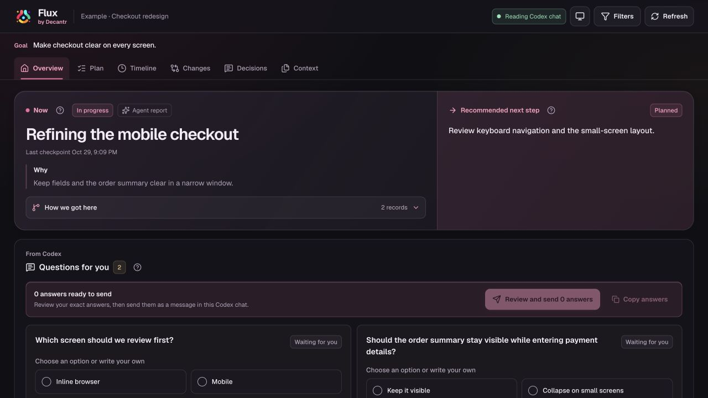
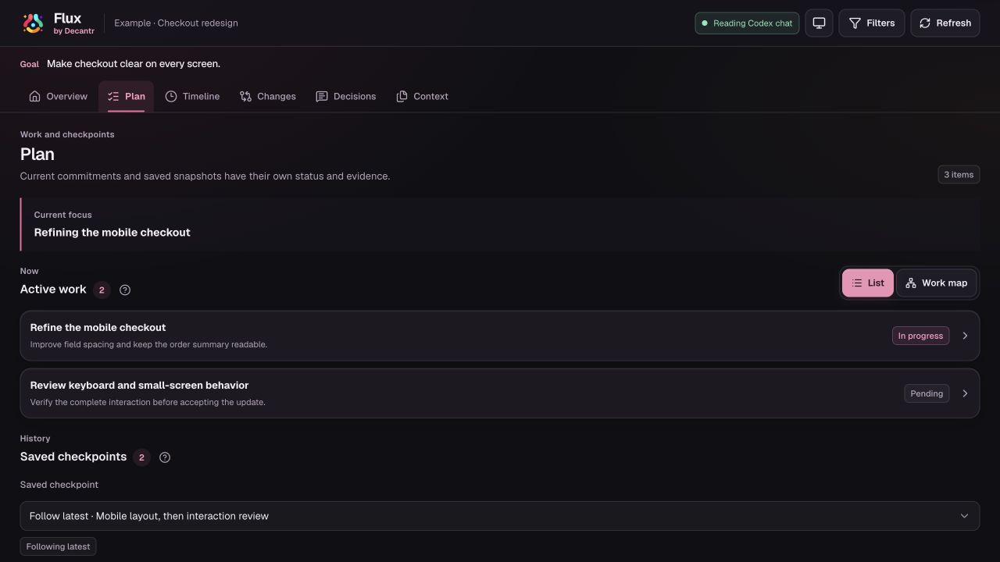
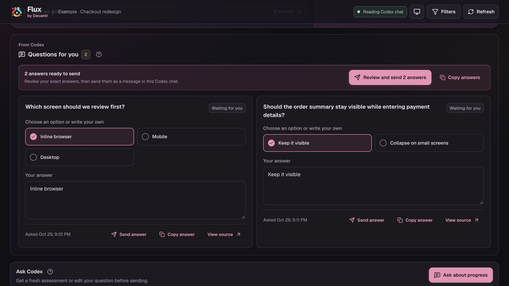

<p align="center">
  
</p>
<h1 align="center">Flux by Decantr</h1>
<p align="center"><strong>Follow the work. Keep the plot.</strong></p>
<p align="center">A local dashboard and project skill beside your Codex chat.</p>
<p align="center">
  <a href="https://decantr.ai/flux/"><strong>See the walkthrough</strong></a> ·
  <a href="docs/INSTALL.md"><strong>Install Flux</strong></a> ·
  <a href="docs/INSTALL.md#3-open-it-beside-your-work">Open beside your chat</a>
</p>



*The running application, using a fictional example project.*

## Know what your agent is doing

Flux keeps the task, recorded plan, questions and decisions in view while you work in Codex. The local service captures supported public activity from the chat you connect; the project skill tells the agent how to record meaningful plans and checkpoints.

| When you need to… | Flux helps you… |
| --- | --- |
| Understand what is happening now | See the recorded focus, its reason and the next step. |
| Return to a long conversation | Inspect the plan, earlier checkpoints and unfinished work. |
| Answer the agent’s questions | Draft replies and review the exact message before sending. |
| Ask why work changed | Select source context for a bounded progress question. |

Connecting enables capture. **The agent must also use the project skill to keep its plan current.** Flux does not read hidden reasoning or automatically enforce a plan.

<details>
<summary><strong>See the plan and checkpoints</strong></summary>



</details>

<details>
<summary><strong>See the questions and answer workflow</strong></summary>



</details>

## Try it before connecting a chat

**Local preview · macOS tested · Node.js 22+ and npm**

```sh
git clone https://github.com/decantr-ai/flux.git
cd flux
npm ci
npm run build
npm run demo
```

Open the local URL printed in the terminal. This example uses disposable fictional records, with chat delivery and native file actions disabled. Stop it with **Ctrl+C**. No Codex account or API key is needed for the example.

**Ready for your own work? [Follow the three-step installation guide →](docs/INSTALL.md)**

> [!NOTE]
> Public source is currently **0.1.0**. There is no npm-registry release. The product tour clearly labels proposed capabilities, including Claude support, the visual scope-check workflow and simpler installation.

## Your work stays local

Flux reads the exact transcript supplied at connection. Its work archive contains captured chat content and project records; keep it private and out of commits. Connecting does not automatically install hooks or send messages. Some UI actions offer explicit, reviewed dispatch through the local Codex client, whose availability must be checked separately.

Flux and Decantr are separate products. Decantr checks UI changes against project evidence. Flux keeps the ongoing work record.

[Installation and troubleshooting](docs/INSTALL.md) · [Package details](docs/PACKAGE.md) · [Explore Flux](https://decantr.ai/flux/)

## Develop

For frontend development, set `FLUX_DEV_API_URL` to an explicit loopback HTTP origin before running `npm run dev`; without it, the dev server does not proxy API requests. The legacy `src/cli.mjs` remains for development fixtures and is not the installed CLI.

Development checks: `npm test`, `npm run check`, and `npm run audit:help`. The synthetic package-install harness in `scripts/harness` uses fake Codex delivery and does not send real chat messages.

## Preview status and license

The local package has been tested on macOS. Other operating systems, native skill discovery and the installed package's real queue delivery remain separate qualification work. Flux is currently all rights reserved (`UNLICENSED`); making this source public does not grant an open-source license. Bundled dependencies retain their own licenses in `THIRD_PARTY_NOTICES.txt` and the font notices.
