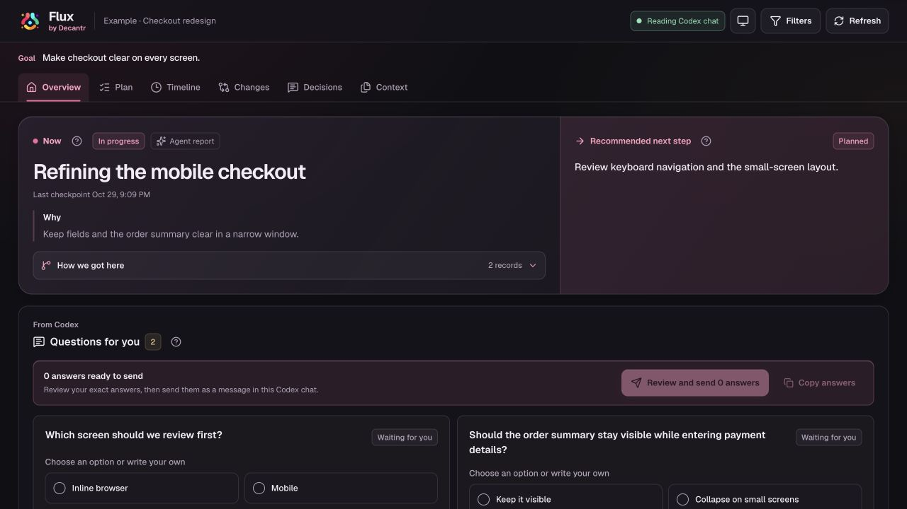
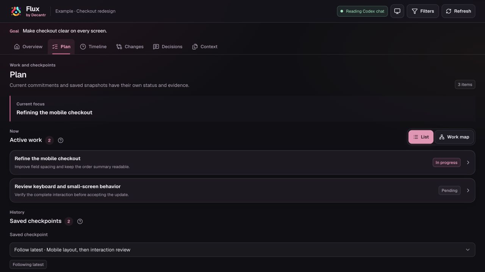
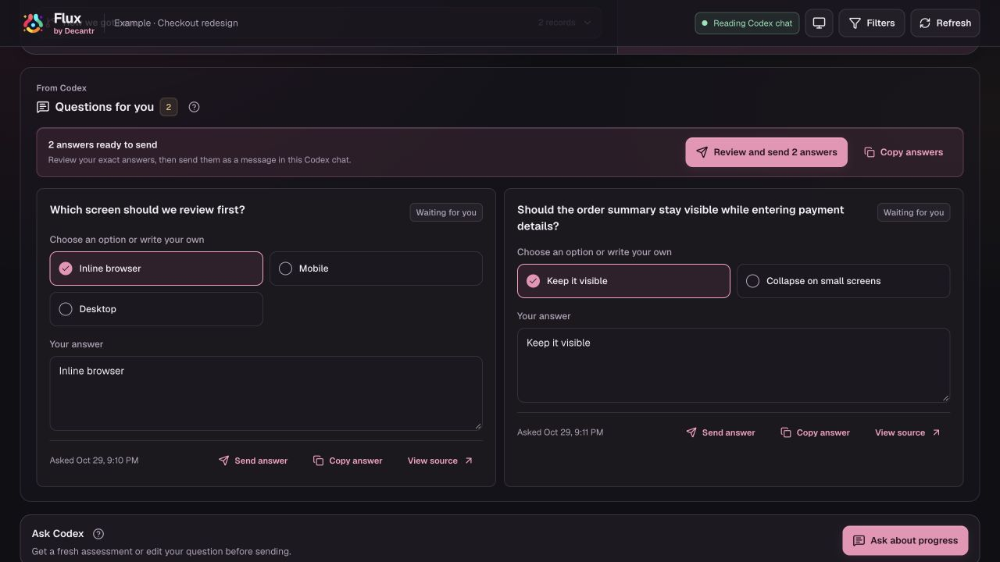

# Flux by Decantr

See what your coding agent is working on, why, and what comes next. Flux brings plans, questions, decisions and source-linked updates into a local dashboard alongside Codex.

**v0.1 local preview** · [Decantr](https://decantr.ai/#flux) · [Install and connect](docs/INSTALL.md)



All screenshots show the running application with a fictional example project.

- **Pick up where you left off.** See the recorded focus and next step, with sources available when you need the detail.
- **Follow the plan as it changes.** Follow the latest checkpoint or pin an earlier version. Keep unfinished work visible.
- **Answer questions deliberately.** Draft one answer or several, inspect the exact message, then send it to the selected chat.
- **Ask about progress with context.** Review a bounded, source-selected question instead of reconstructing a long chat yourself.

<details>
<summary>See the plan and checkpoints</summary>



</details>

<details>
<summary>See the questions and answer workflow</summary>



</details>

## Try it from source

Requirements: Node.js 22 or later and npm. Clone the repository, then run:

```sh
git clone https://github.com/decantr-ai/flux.git
cd flux
npm ci
npm run build
npm run demo
```

Open the URL printed by the demo. It uses disposable synthetic records and blocks chat delivery and native file actions. Press Ctrl+C to stop it. No Codex account or API key is needed for the example.

Run `npm run pack:local` to build an installable archive and checksum in `dist/`. See [installation](docs/INSTALL.md) to connect your own project and exact chat, and [package notes](docs/PACKAGE.md) for boundaries. `npm start -- help` lists source CLI commands; `npm start -- open --project <directory> --session <id>` opens an already connected chat. There is no npm-registry release yet.

## What Flux records

Flux only reads the exact transcript supplied at connection. It does not automatically install hooks or send messages. Some actions offer explicit, reviewed dispatch through Codex; availability depends on the local Codex environment. Transcript capture provides public messages and limited activity, not hidden reasoning or a complete account of work. Plans and explanations are recorded claims rather than inferred model thoughts.

## Develop

For frontend development, set `FLUX_DEV_API_URL` to an explicit loopback HTTP origin before running `npm run dev`; without it, the dev server does not proxy API requests. The legacy `src/cli.mjs` remains for development fixtures and is not the installed CLI.

Development checks: `npm test`, `npm run check`, and `npm run audit:help`. The synthetic package-install harness in `scripts/harness` uses fake Codex delivery and does not send real chat messages.

## Preview status and license

The local package has been tested on macOS. Other operating systems, native skill discovery and the installed package's real queue delivery remain separate qualification work. Flux is currently all rights reserved (`UNLICENSED`); making this source public does not grant an open-source license. Bundled dependencies retain their own licenses in `THIRD_PARTY_NOTICES.txt` and the font notices.
