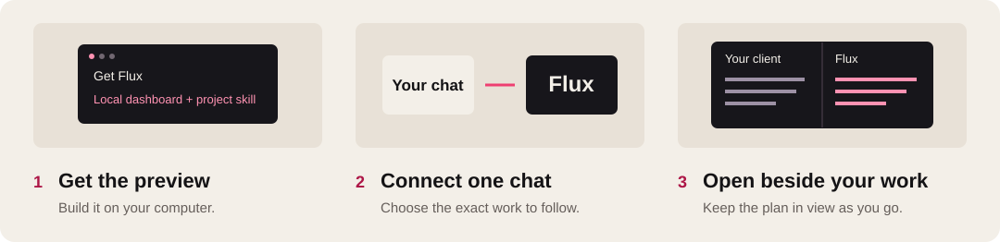
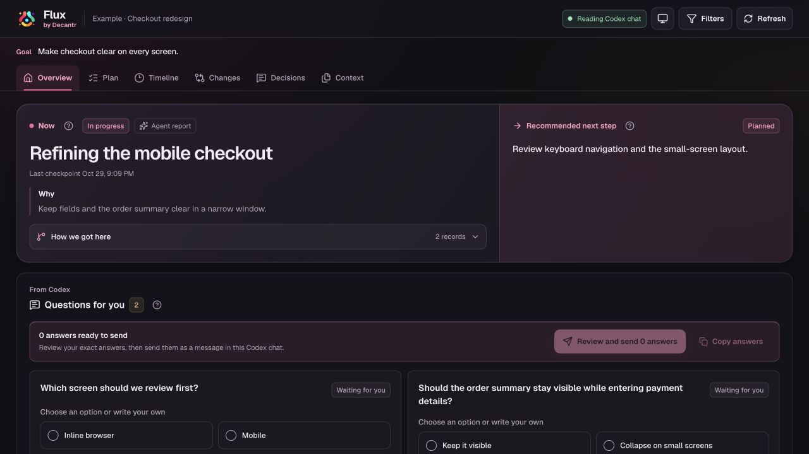

<p align="center">
  
</p>
<h1 align="center">Get started with Flux</h1>
<p align="center">Your AI chat keeps working. You keep the work and the plan in view.</p>
<p align="center">
  <a href="https://decantr.ai/flux/">Explore Flux</a> ·
  <a href="#1-get-flux">Get started</a> ·
  <a href="#troubleshooting">Troubleshooting</a> ·
  <a href="../README.md">Back to the repository</a>
</p>



> [!NOTE]
> **Local preview · macOS tested · Node.js 22+ and npm**<br>
> This guide matches the published **0.1.0** source. Install from source or a locally built archive; there is no npm-registry release. Claude integration and the visual scope-check workflow on the product tour are proposed.

## 1. Get Flux

Run these commands in a terminal:

```sh
git clone https://github.com/decantr-ai/flux.git
cd flux
npm ci
npm run build
```

**You now have the local dashboard and CLI.** Keep this checkout where you want Flux to run.

<details>
<summary><strong>Just looking? Try the example first</strong></summary>

```sh
npm run demo
```

Open the local URL printed in the terminal. You’ll see a fictional checkout project in the real Flux interface. Nothing connects to your chats; delivery and native file actions are disabled. Stop the example with **Ctrl+C**.

</details>

## 2. Connect one chat

In the Codex chat you want to follow, paste:

```text
Set up Flux from my local Flux checkout for this project and this exact chat.
Follow docs/INSTALL.md. Verify the project, chat ID and matching transcript,
install the project skill, and connect only this chat. Start Flux and give me
its local dashboard URL. Use the installed project helper to record our
current agreed focus and plan, then keep checkpoints current as work changes.
```

**Codex needs the exact project, chat ID and local transcript.** A chat title alone is not enough. If your client cannot provide them, supply them before connecting.

<details>
<summary><strong>Prefer the terminal? Connect manually</strong></summary>

From the Flux checkout, replace these three quoted values:

```sh
PROJECT="/absolute/path/to/your/project"
CHAT_ID="exact-codex-chat-id"
TRANSCRIPT="/absolute/path/to/matching-rollout.jsonl"

node bin/flux.mjs connect --project "$PROJECT" --session "$CHAT_ID" --transcript "$TRANSCRIPT"
node bin/flux.mjs install-skill --project "$PROJECT"
node bin/flux.mjs open --project "$PROJECT" --session "$CHAT_ID"
```

`connect` checks the transcript’s session identity. `install-skill` adds the managed skill under your project’s `.agents/skills/flux/`. `open` starts or reuses the service, opens the system browser and returns its local URL.

</details>

> [!TIP]
> **Capture and checkpoints are different.** Connecting captures supported public activity. The agent must use the project skill to record its plan, decisions and checkpoints. Installing the skill files alone does not prove the running agent has read them.

## 3. Open it beside your work

Use the `http://127.0.0.1:…` URL returned by Flux **on the same computer**.

| Where you work | Where Flux goes |
| --- | --- |
| **Codex in the desktop app** | Open **New tab**, paste the URL, then choose **Enter split view**. Keep your chat and Flux visible together. |
| **CLI or an editor** | Open the URL in a regular browser window and place it beside your terminal or editor. |

`open` launches the system browser; it does not arrange windows or embed Flux automatically. [Official desktop browser instructions](https://learn.chatgpt.com/docs/browser)

**Your first useful view:** activity is arriving, Overview names the agreed work, and Plan contains a saved checkpoint. If the plan is empty, ask Codex to use this project’s Flux skill and record it.



## Keep working normally

Continue the conversation in Codex. Use Flux whenever you need orientation:

| You want to… | Open… |
| --- | --- |
| See the current task, reason and next step | **Overview** |
| Inspect the recorded plan and its earlier versions | **Plan** and **Changes** |
| Follow a particular update and its sources | **Timeline** |
| Understand a recorded choice | **Decisions** |
| Inspect the selected context | **Context** |

Questions and replies are reviewed before sending. Delivery depends on your local Codex client; connecting a transcript does not establish that sending is available. Flux does not read hidden reasoning or automatically enforce a plan.

<details>
<summary><strong>Make sure Codex uses this project’s skill</strong></summary>

```text
Use this project's .agents/skills/flux/SKILL.md and its installed helper.
Record the plan we have actually agreed on. Keep the focus and checkpoints
current at meaningful work boundaries, with links to their source evidence.
```

Use `$flux` when your client exposes it. If a global Flux skill also exists, explicitly name the project skill above. Discovery depends on the client’s working directory; a chat opened in a parent directory may need the exact path.

From your project directory, with the same `CHAT_ID` used for connection:

```sh
node .agents/skills/flux/scripts/flux.mjs snapshot --session "$CHAT_ID"
```

The helper supplies its project binding. Do not add `--project` or `--state-root` to it.

</details>

## Troubleshooting

| What you see | What to do |
| --- | --- |
| **The dashboard won’t open** | From the Flux checkout, run `node bin/flux.mjs status --project "$PROJECT" --session "$CHAT_ID"`. A verified running service returns its URL. |
| **The status says `unverified`** | Flux cannot confirm the saved service’s identity. Do not assume it is stopped or keep starting copies. Inspect the returned status first. |
| **Activity appears, but the plan is empty or stale** | Ask the agent to read the installed project skill and reconcile the plan with your latest instruction. Capture does not create semantic checkpoints by itself. |
| **I have several chats or worktrees** | Connect each exact project/chat pair explicitly. Do not reuse another chat’s ID or guess from its title. |
| **The installed skill already exists** | Flux preserves modified or differently bound skills. Review the existing files before removing or replacing them. |
| **Sending a question is unavailable** | Continue in the Codex chat. Native delivery is client-dependent; the local dashboard can still show recorded work. |

The command examples use `PROJECT` and `CHAT_ID` from the manual setup above. Re-create those variables in a new terminal, or substitute quoted values directly.

<details>
<summary><strong>Stop Flux or disconnect a chat</strong></summary>

From the Flux checkout, using the same project and chat:

```sh
node bin/flux.mjs stop --project "$PROJECT" --session "$CHAT_ID"
```

To disable capture as well:

```sh
node bin/flux.mjs disconnect --project "$PROJECT" --session "$CHAT_ID"
```

Both retain the work records. Check the returned shutdown result. Reconnect explicitly when capture is wanted again.

To remove an unchanged managed project skill:

```sh
node bin/flux.mjs uninstall-skill --project "$PROJECT"
```

Stop or disconnect the service before removing its runtime. Removing the skill does not delete recorded work.

</details>

<details>
<summary><strong>Install a runtime independent of the checkout</strong></summary>

From the Flux source checkout:

```sh
npm run pack:local
FLUX_PREFIX="$HOME/.local/share/decantr-flux"
FLUX_VERSION="$(node -p 'require("./package.json").version')"
npm install --prefix "$FLUX_PREFIX" --omit=dev --ignore-scripts --no-audit --no-fund "$(pwd)/dist/decantr-flux-$FLUX_VERSION.tgz"
export PATH="$FLUX_PREFIX/node_modules/.bin:$PATH"
flux version
```

You can now use `flux` instead of `node bin/flux.mjs`. The PATH change applies only to this terminal; use the full executable path or add that directory to your shell’s PATH for future terminals.

Choose the runtime before installing the project skill: the helper is bound to that runtime. A differently bound or modified skill is preserved, not silently replaced.

</details>

<details>
<summary><strong>Local data, privacy and service recovery</strong></summary>

Flux’s work archive lives under `<project>/.flux/chats/` and contains captured public chat content and project records. “Public” here means messages visible in the chat, not information safe to publish. **Keep this directory private and out of commits.** Flux creates a `.flux/.gitignore` for a new workspace; existing ignore rules are preserved.

Connecting does not install hooks or automatic message dispatch. Explicit, reviewed send actions can transmit selected context to the Codex client. This is a local preview, not a remote telemetry service.

Flux preserves the selected loopback port across ordinary restarts. Changing ports changes the browser origin and can make browser-local drafts unavailable. It refuses to start a second service when an occupied port cannot be authenticated.

Long transcripts and multiple services can consume substantial memory. Stop idle services when appropriate. Other operating systems and native client behavior need their own qualification.

A crashed lifecycle command can leave a lock. Confirm that no connect/start/stop operation is running before manually removing its `lifecycle.lock` directory. Never remove locks during normal work.

</details>

---

[Explore Flux](https://decantr.ai/flux/) · [Package notes](PACKAGE.md) · [Repository](../README.md)
